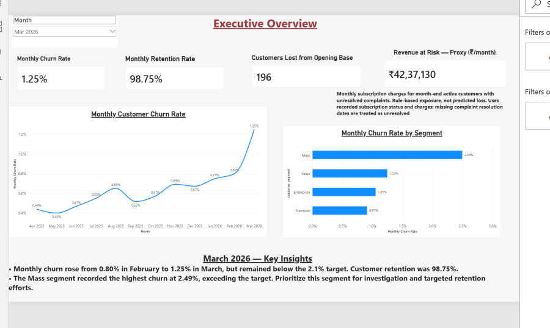

# NexaTel Customer Churn Analysis

An internship case study using Python and Power BI to explore customer churn, service quality, retention outcomes and revenue exposure.

## Project Objective
Identify patterns associated with customer churn and recommend actions to improve retention and protect revenue.

## Tools Used
- Python: Pandas, NumPy, Matplotlib and Seaborn
- Jupyter Notebook
- Power BI

## Project Workflow
1. Data cleaning and quality checks across 24 CSV tables.
2. Exploratory analysis with 10 charts and observations.
3. Calculation of business KPIs and cohort retention analysis.
4. Development of a five-page Power BI dashboard and management report.

## Dashboard Pages
1. Executive Overview
2. Customer & Segment
3. Service & Support
4. Network & Regional
5. Campaigns & Revenue

## Key Findings — March 2026
- Monthly customer churn was 1.25%, with retention of 98.75%.
- The Mass segment had the highest monthly churn at 2.49%.
- Customers with unresolved complaints at month start had higher churn: 1.66% versus 1.08%.
- First-contact resolution was 41.04%; average resolution time was 15.21 hours.
- Month-end recurring revenue was approximately ₹1.47 crore under the subscription-based proxy.

These findings describe associations and do not establish causation.

## Repository Contents
| Folder | Contents |
|---|---|
| notebooks | Data cleaning, exploratory analysis and KPI notebooks |
| dashboard | Power BI dashboard (.pbix) |
| reports | Management summary report |
| charts | 10 exploratory analysis charts |
| screenshots | Five dashboard page screenshots |

## Dashboard Preview

## How to Explore
- Start with the dashboard screenshots and management report.
- Open the notebooks to review the analysis and recorded outputs.
- Download the .pbix file and open it in Power BI Desktop for interactive exploration.
- Rerunning the notebooks requires the source CSV files and the folder paths used in the notebooks. Run Phase 1, then Phase 2 and Phase 3.

## Assumptions and Limitations
- Revenue-at-risk is rule-based monthly exposure, not predicted loss.
- Revenue lost to churn uses prior-month billing and is not actual accounting loss.
- Historical MRR is approximate because historical subscription status and price changes are unavailable.
- Tenure analysis represents the March 2026 snapshot.
- Campaign retention reflects recorded outcomes and does not prove campaign effectiveness.
- Dashboard insight text describes March 2026 and may not change with slicer selections.

## Author
Anushka Tyagi
